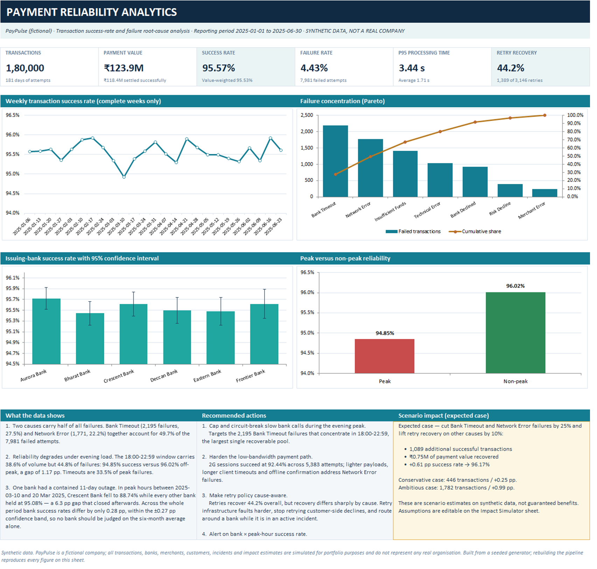

# Payment Reliability Analytics

**Transaction success-rate and failure root-cause analysis for a digital-payments platform — built end to end in SQL, Python and Excel, and finished with a scenario simulator that sizes what fixing the top two failure causes would be worth.**



> ### Synthetic data disclosure
> **Every row, entity and number in this project is synthetic.** "PayPulse" is a fictional company. The transactions, customers, merchants, issuing banks, the March outage and all impact estimates are generated by a seeded script in [`src/generate_data.py`](src/generate_data.py) for portfolio purposes. **This project does not use PhonePe data, or data from any other real company**, and none of the findings describe a real organisation.

---

## Business context

A digital-payments platform makes money only when a payment attempt succeeds. A success rate that drifts from 95.6% to 95.0% sounds harmless in a board pack, yet on this volume it is thousands of failed payments, a support queue, and customers who quietly switch to a competing app.

The hard part is not measuring the rate — it is answering *why*. Payment failures come from many places at once: an issuing bank timing out under load, a customer on a weak mobile connection, an account without funds, a risk engine declining a transaction. Those causes need completely different owners and completely different fixes, and only some of them are the platform's to solve.

PayPulse's leadership asked a simple question: **where is reliability actually being lost, how much of it can we do something about, and what would fixing it be worth?**

## Questions this project answers

1. How reliable is the platform overall — by transaction count *and* by payment value?
2. Is reliability improving, degrading, or flat over six months?
3. Which failure causes matter, ranked by the volume they carry rather than by rate?
4. Does reliability degrade under load, and if so, when exactly?
5. Is any single issuing bank genuinely worse — or is the apparent gap just noise?
6. Was the March dip a real, contained incident or a structural problem?
7. Is the retry policy recovering the failures that are actually recoverable?
8. If the top two causes were reduced, how many transactions and how much payment value would be recovered?

## Workflow

```
src/generate_data.py     seeded synthetic generator      180,000 transactions, engineered patterns
        v
src/validate_data.py     19 data-quality checks          pipeline stops if the contract breaks
        v
src/build_database.py    SQLite + transaction_enriched   business definitions injected from config.py
        v
sql/01..06 + run_analysis.py                             16 result tables -> outputs/analysis/*.csv
        v                                                + summary.json (single source of truth)
src/build_excel_dashboard.py                             9-sheet workbook, formulas + charts
        v
scripts/excel_qa.ps1     Excel COM verification          recalculates, scans for errors, renders PNGs
        v
tests/                   52 pytest checks                generator, SQL/Python reconciliation, workbook
```

One command runs all of it — see [Reproducing this project](#reproducing-this-project).

## The dataset

180,000 synthetic payment attempts over **1 January – 30 June 2025** (181 days), worth **₹123.9M** attempted value, across 6 fictional issuing banks, 5 payment methods, 12 Indian cities, 3 device types and 5 network types.

Failure probability is not random noise. It is built from small additive drivers — evening peak load, poor mobile network, high transaction value, one Android sub-cohort, redirect-based net banking — plus **one deliberately engineered, time-bounded outage** for a single bank. Those drivers are the ground truth the SQL analysis has to recover, which is what makes the project testable rather than decorative.

| | |
|---|---|
| Rows / columns | 180,000 × 20 |
| Reporting period | 2025-01-01 to 2025-06-30 |
| Full dataset | `data/generated/transactions.csv` (~30 MB, regenerated, not committed) |
| Committed sample | [`data/sample_transactions.csv`](data/sample_transactions.csv) (5,000 rows) |
| Field definitions | [`docs/data_dictionary.md`](docs/data_dictionary.md) |

## KPI definitions

| KPI | Definition | Denominator | This dataset |
|---|---|---|---|
| Transaction success rate | Attempts that succeeded **on the initial attempt** | All attempts | **95.57%** |
| Value success rate | Attempted payment value that succeeded | Total attempted value | 95.53% |
| Failure rate | Attempts that failed | All attempts | 4.43% (7,981 attempts) |
| Average processing time | Mean end-to-end attempt latency | All attempts | 1.71 s |
| P95 processing time | 95th percentile latency | All attempts | 3.44 s |
| Retry rate | Attempts that were retried | All attempts | 1.75% |
| Retry rate of failures | Failed attempts that were retried | Failed attempts | 39.42% |
| Retry recovery rate | Retries that eventually succeeded | Retried attempts | 44.15% |
| Failure contribution | Share of all failures from one cause | Failed attempts | Bank Timeout: 27.50% |
| Peak-hour gap | Non-peak success rate − peak success rate | Peak = 18:00–22:59 | 1.17 pp |
| 95% CI half-width | `1.96 × sqrt(p(1−p)/n)` on a segment rate | One segment | up to ±0.27 pp across banks |

**`transaction_status` is the outcome of the initial attempt.** Retry recoveries are tracked separately in `final_retry_outcome`, so the headline success rate is never inflated by retries. Both are reported, and the difference between them is itself a finding.

## SQL techniques demonstrated

Six numbered files in [`sql/`](sql/), run in order against SQLite:

| Technique | Where |
|---|---|
| CTEs (`WITH`) | Every file — staged aggregation before ranking |
| `CASE` expressions | Status/value conditionals, period labelling, band assignment |
| Window functions | `SUM() OVER ()` for contribution shares, `AVG() OVER (ORDER BY ... ROWS BETWEEN 6 PRECEDING AND CURRENT ROW)` for the 7-day moving average |
| `LAG` | Month-over-month, week-over-week and day-over-day movement |
| `RANK()` | Failure Pareto, worst-hour ranking, bank × hour impact, rank within each segment dimension |
| Safe division | `NULLIF(denominator, 0)` on every ratio |
| Scalar subqueries | Gap-to-portfolio-rate columns |
| Aggregation + `HAVING` | Bank × hour cells below 300 attempts are excluded from prioritisation |
| `UNION ALL` | One reusable scorecard across 8 categorical dimensions |
| Statistical guardrail | 95% confidence half-width computed in SQL so noisy segments are visible as noisy |

## Key findings

*All figures below come from the committed pipeline run and are reproduced exactly by re-running it.*

### 1. Two causes carry half of all failures

| Failure cause | Failures | Share | Cumulative | Failed value |
|---|---:|---:|---:|---:|
| **Bank Timeout** | 2,195 | 27.50% | 27.50% | ₹1,448,136 |
| **Network Error** | 1,771 | 22.19% | **49.69%** | ₹1,287,748 |
| Insufficient Funds | 1,404 | 17.59% | 67.28% | ₹943,835 |
| Technical Error | 1,039 | 13.02% | 80.30% | ₹758,035 |
| Bank Declined | 928 | 11.63% | 91.93% | ₹644,151 |
| Risk Decline | 401 | 5.02% | 96.96% | ₹301,831 |
| Merchant Error | 243 | 3.04% | 100.00% | ₹155,364 |

Two of seven causes explain **49.69%** of all failures — and both are infrastructure failures the platform can influence, unlike Insufficient Funds or Risk Decline, which are customer- and policy-side.

### 2. Reliability degrades under evening load

The **18:00–22:59** window carries **38.60% of volume but 44.83% of failures**: 94.85% success versus 96.02% off-peak, a gap of **1.17 pp**. The cause mix shifts too — timeouts are **33.54%** of peak failures against **22.60%** off-peak, and **54.67%** of all Bank Timeout failures land inside those five hours. That signature points at capacity pressure, not customer behaviour. The worst hours are 18:00 and 19:00, both at 94.70%.

Connection quality compounds it: 2G sessions succeed at **92.44%** (5,383 attempts) and 3G at 94.42% (21,596 attempts), against 95.86% on 4G.

### 3. One bank had a contained 11-day outage — and the six-month bank ranking is noise

Across the whole period the six banks sit between 95.44% and 95.72% — a spread of **0.28 pp** against a 95% confidence half-width of up to **±0.27 pp**. The intervals overlap, so **the six-month bank ranking is not actionable**, and the lowest-rate bank (Bharat Bank) is not the bank with a real problem.

Cutting by bank *and* time tells a completely different story. In peak hours only:

| Bank group | Before (1 Jan – 9 Mar) | During (10–20 Mar) | After (21 Mar – 30 Jun) |
|---|---:|---:|---:|
| **Crescent Bank** | 95.53% | **88.74%** | 95.06% |
| All other banks | 94.89% | 95.08% | 94.81% |

Crescent Bank's peak-hour timeout rate rose from **1.45% to 5.93%** during the window and returned to 1.50% afterwards, while every other bank was unmoved in the same hours — a **6.34 pp** gap that opened and closed. That is a contained incident, and it is invisible in the portfolio average, which moved only from 95.65% to 94.97%.

### 4. Retry policy is not cause-aware

Retries are attempted on 39.42% of failures and recover 44.15% of those. But recovery differs sharply by cause: **Bank Timeout recovers at 53.10%** and Bank Declined at 49.21%, while **Insufficient Funds recovers at 27.12%** and Risk Decline at 25.00%. Retries are currently spread almost evenly across causes (38.4%–41.9% of each), which means the platform spends the same retry effort on failures that will almost never recover as on the ones that usually do.

## Recommendations

1. **Cap and circuit-break slow issuing-bank calls during the evening peak.** Targets the 2,195 Bank Timeout failures, 54.67% of which occur in the five peak hours — the largest single addressable pool.
2. **Harden the low-bandwidth payment path.** Lighter payloads, longer client timeouts and offline confirmation for 2G/3G sessions, which fail 1.4–3.4 pp more often than 4G and drive the 1,771 Network Error failures.
3. **Make retry policy cause-aware.** Retry infrastructure faults harder (timeouts recover >50%), stop retrying customer-side declines (<28%), and route around an issuing bank while it is in an active incident.
4. **Alert on bank × peak-hour success rate, not the daily average.** The March incident is only visible in that cut; the portfolio average never moved a full point.

## Scenario impact

The [Impact Simulator](outputs/Payment_Reliability_Analytics_Dashboard.xlsx) sheet converts a reduction in a measured failure pool into recovered transactions and payment value. Three levers act on **mutually exclusive** pools, so nothing is double-counted:

| Scenario | Timeout ↓ | Network ↓ | Retry uplift | Recovered transactions | Recovered value | Success rate |
|---|---:|---:|---:|---:|---:|---:|
| Conservative | 10% | 10% | 5% | 446 | ₹306,164 | 95.57% → 95.81% (+0.25 pp) |
| **Expected** | **25%** | **25%** | **10%** | **1,089** | **₹749,123** | **95.57% → 96.17% (+0.61 pp)** |
| Ambitious | 40% | 40% | 20% | 1,782 | ₹1,224,658 | 95.57% → 96.56% (+0.99 pp) |

These are **scenario estimates on synthetic data, not forecasts and not evidence of realised benefit.** The model excludes customer re-attempt behaviour, the cost or risk of each intervention, fraud effects of retrying more, and interaction between the levers. The assumptions are editable in the workbook.

## Excel dashboard

[`outputs/Payment_Reliability_Analytics_Dashboard.xlsx`](outputs/Payment_Reliability_Analytics_Dashboard.xlsx) — 9 sheets, 10 charts, no PivotTables or macros:

| # | Sheet | What it does |
|---|---|---|
| 1 | **Executive Dashboard** | 6 KPI cards, weekly trend, failure Pareto, bank comparison with error bars, peak vs non-peak, three findings, four actions, scenario impact |
| 2 | **Trend Analysis** | Monthly scorecard with MoM movement, weekly success rate (complete weeks only), daily rate with 7-day moving average |
| 3 | **Failure Analysis** | Pareto table and combined column/cumulative-line chart, peak vs non-peak, 24-hour profile |
| 4 | **Bank and Segment Analysis** | Bank scorecard with 95% CIs, the before/during/after incident comparison, scorecards for 8 dimensions, bank × hour impact ranking |
| 5 | **Impact Simulator** | Yellow editable inputs (validated 0–100%), formula-driven outputs, scenario chart, explicit limitations |
| 6 | **KPI Definitions** | One row per KPI: definition, formula, denominator, this dataset's value, how to interpret it |
| 7 | **Data Dictionary** | All 20 fields with business meaning and analysis notes |
| 8 | **Analysis Data** | The reconciliation layer — every exported SQL table and every summary metric |
| 9 | **Read Me** | Scope, definitions, limitations, how to rebuild |

**Every presentation number is a formula pointing at the Analysis Data sheet.** Nothing is typed in twice, so the workbook reconciles to the SQL outputs by construction. Formulas are written with their computed result cached, so the file shows correct values in any viewer — and `scripts/excel_qa.ps1` opens it in Excel, forces a full recalculation, and confirms the recalculated values still match `summary.json`.

## Repository structure

```
Payment-Reliability-Analytics-project/
├── data/
│   ├── README.md                     what is and is not committed, and why
│   ├── sample_transactions.csv       5,000-row committed sample
│   └── generated/                    full CSV + SQLite (gitignored, reproducible)
├── docs/
│   ├── methodology.md                design decisions, definitions, honest limitations
│   ├── data_dictionary.md            all 20 fields
│   └── portfolio_notes.md            resume bullets and interview preparation
├── outputs/
│   ├── analysis/                     16 result tables + summary.json
│   ├── Payment_Reliability_Analytics_Dashboard.xlsx
│   └── dashboard_preview.png
├── reports/
│   └── executive_summary.md          one-page stakeholder report
├── scripts/
│   └── excel_qa.ps1                  Excel COM verification and sheet rendering
├── sql/                              01..06, run in order
├── src/
│   ├── config.py                     single source of truth for paths and definitions
│   ├── generate_data.py              seeded synthetic generator
│   ├── validate_data.py              19 data-quality checks
│   ├── build_database.py             SQLite + transaction_enriched view
│   ├── run_analysis.py               runs the SQL, exports CSVs, builds summary.json
│   ├── build_excel_dashboard.py      the 9-sheet workbook
│   └── run_pipeline.py               one-command orchestration
├── tests/                            52 pytest checks
├── requirements.txt
└── run_pipeline.ps1                  Windows wrapper
```

## Reproducing this project

```bash
pip install -r requirements.txt
```

Then, from the repository root, one command runs everything — generate, validate, build the database, run the SQL, export the analysis, build the workbook, render the preview and run the tests:

```bash
python src/run_pipeline.py
```

On Windows you can use the wrapper instead:

```powershell
.\run_pipeline.ps1
```

Useful flags: `--rows 20000` for a fast run, `--skip-generate` to reuse the existing dataset, `--skip-preview` to skip Excel rendering, `--skip-tests` to skip the suite.

Everything is deterministic: the generator is seeded (`SEED = 20250813` in `src/config.py`), so a fresh clone reproduces the same 180,000 rows, the same findings and the same workbook figures. **The preview step is the only part that needs Windows with Excel installed**; on any other platform it is skipped with a message and every other output is still produced.

## Tests and validation

Two independent layers:

**Pipeline validation** — [`src/validate_data.py`](src/validate_data.py) runs 19 checks before any analysis happens (unique IDs, positive amounts, allowed categories, status/failure-reason consistency, retry consistency, timestamps inside the period, completeness, plausible success rate) and aborts the run on any failure.

**Test suite** — 52 pytest checks in [`tests/`](tests/):

```bash
python -m pytest -q
```

- **Generator** — determinism for a fixed seed, sensitivity to a different seed, schema, uniqueness, allowed values, status/reason and retry consistency, and that the engineered peak and incident patterns are actually present.
- **Validation** — six corrupted datasets are each caught by the right check.
- **Reconciliation** — headline KPIs recomputed independently in pandas must match the SQL outputs and `summary.json`; the database row count, the Pareto contributions, per-dimension contribution sums, the moving average, the retry table and the simulator pools all have to agree.
- **Workbook** — sheet names and order, no error cells or error literals anywhere in the XML, KPI cards are cross-sheet formulas with correct cached values, simulator inputs are editable and range-validated, simulator outputs are safe-division formulas, gridlines hidden, header panes frozen.

The workbook is additionally verified inside Excel by `scripts/excel_qa.ps1`, which forces a full recalculation and confirms 19 recalculated values still match `summary.json`.

## Limitations

- **The data is synthetic.** Patterns were engineered so they could be recovered; real payment data is messier, has more confounding, and would not yield this clean a Pareto.
- **This is diagnosis, not causal inference.** The incident analysis is a difference-in-differences *style* comparison, not a controlled experiment. It is convincing because the affected bank moves and the control group does not — but no causal claim is made.
- **Impact figures are scenario estimates.** They assume prevented failures convert to successes at each pool's observed average value, and ignore cost, capacity, customer substitution and lever interaction.
- **The success rate is initial-attempt only.** Including retry recoveries would raise it by roughly 0.77 pp; both views are reported rather than blended.
- **High-value segments are thin.** Only 499 attempts exceed ₹10,000, so that band is flagged as low-sample and no recommendation is built on it.
- **Six months, one platform.** No seasonality beyond the window, no competitor or market context, no cost or revenue model.

## Skills demonstrated

**SQL** — CTEs, window functions, `LAG`, `RANK`, safe division, Pareto and contribution analysis, period-over-period movement, before/during/after event analysis, statistical guardrails in-query.
**Python** — deterministic data generation with NumPy, pandas analysis, a validation gate, XlsxWriter reporting with live formulas and charts, pytest, pipeline orchestration.
**Analytics** — KPI definition and denominator discipline, root-cause prioritisation by volume rather than rate, distinguishing signal from sampling noise, incident analysis, scenario modelling with stated assumptions.
**Communication** — an executive dashboard, a one-page stakeholder report, honest limitations, and a workbook a non-technical reader can use without asking how it was built.

## Interview talking points

- *"The lowest-scoring bank was not the bank with the problem."* Bharat Bank has the lowest six-month rate, but the spread across banks (0.28 pp) is inside the confidence interval (±0.27 pp). The real finding needed a bank × time × peak-hour cut — that is the difference between reading a table and doing analysis.
- *"I prioritised by volume, not by rate."* 2G has the worst success rate in the dataset at 92.44%, but only 5,383 attempts. Bank Timeout has a smaller rate effect and 2,195 failures. Recommendation 1 targets the pool, not the rate.
- *"I separated what we own from what we do not."* Insufficient Funds is 17.59% of failures and is not an engineering problem. The scenario model deliberately targets only the two infrastructure causes.
- *"The workbook cannot disagree with the analysis."* Every cell is a formula into one reconciliation sheet, cached values are written by the builder, and CI-style checks recalculate the file in Excel and compare it back to `summary.json`.
- *"I said what the model does not claim."* The simulator has a visible assumptions block and an explicit list of what it excludes — that is what makes a number usable in a real decision.

## License

[MIT](LICENSE) — synthetic data and code are free to reuse.
